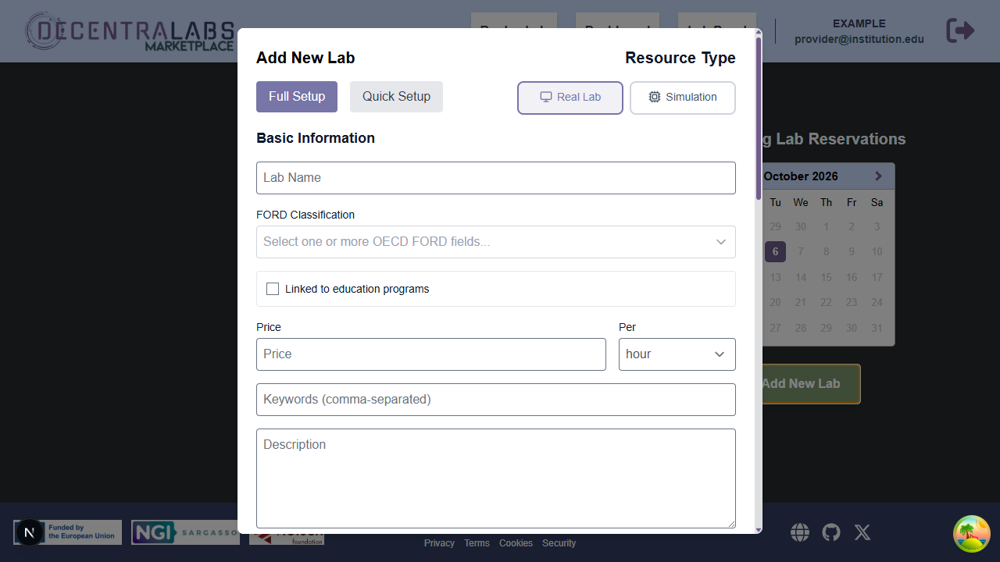
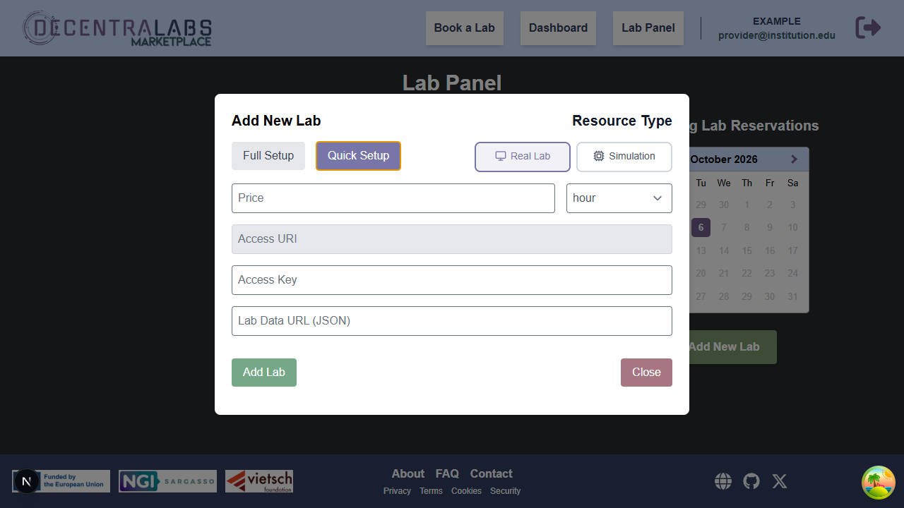

# Configure and publish your lab

Once the institution has been onboarded and the provider role is available, open the **Lab Panel** and select **Add New Lab**. The normal provider flow uses institutional SSO and the institution's managed backend. It does not require a personal Web3 wallet, a network selection, a browser gas payment or a direct Marketplace transaction.

The screenshot uses fictitious example data and shows the current provider
dialog, including the **Full Setup**/**Quick Setup** choice and the **Real Lab**
/**Simulation** resource type.

The form offers **Full Setup** and **Quick Setup**. Both flows send authorized changes through the institution's configured backend; the backend performs the on-chain operation with the managed institutional wallet.

## Full Setup

Full Setup is the guided option for entering the laboratory information in the Marketplace.

1. Sign in with institutional SSO and open the **Lab Panel**.
2. Select **Add New Lab** and choose **Full Setup**.
3. Complete the basic information, OECD-FORD category, description, availability, time zone, booking options, concurrency and access requirements.
4. Set the price and its unit. Supported display units are `minute`, `hour`, `day`, `week` and `month`. The contract stores the normalized per-second value, while the catalogue and detail page show the configured unit.
5. Add images and documentation. Apply the public-data rules in
   [Marketplace metadata integration](../provider/metadata-integration.md).
6. Review the form and submit it. Wait for the institutional backend and on-chain confirmation before treating the lab as published.

Marketplace-managed metadata is covered in
[Marketplace metadata integration](../provider/metadata-integration.md); the
field catalogue and validation rules remain in the separate
[Lab-Metadata schema](https://github.com/DecentraLabsCom/Lab-Metadata/blob/main/docs/metadata-schema.md).

## Quick Setup

Quick Setup is for providers that already maintain a metadata document at an external origin.

1. Prepare a JSON document using the [normative Lab-Metadata schema](https://github.com/DecentraLabsCom/Lab-Metadata/blob/main/docs/metadata-schema.md) and its [provider examples](https://github.com/DecentraLabsCom/Lab-Metadata/blob/main/docs/examples.md).
2. Host it at an HTTPS URL that satisfies the exact-origin rules in
   [Marketplace metadata integration](../provider/metadata-integration.md).
3. Sign in with institutional SSO, open **Add New Lab** and choose **Quick Setup**.
4. Enter the price, display unit and metadata URL, then review the listing state.
5. Submit the authorized operation and wait for backend/on-chain confirmation.

The metadata URL is public catalogue input. Keep access URLs, access keys, service credentials and institutional contact details outside the public document.

Quick Setup keeps the provider input small: price and unit, access endpoint,
access key and the public metadata URL. The values shown in the capture are
illustrative only.

## Choose the laboratory experience

The **Real Lab**/**Simulation** choice in **Add New Lab** determines what kind
of resource a reservation opens. A simulation lab then has one of three
presentation styles. The listing, reservation and access authorization flow is
the same; the files and the view presented to the user differ.

| Type selected in Add New Lab | What the user gets after reserving | What the provider prepares |
| --- | --- | --- |
| **Real Lab** | Access to the provider's physical equipment and its configured remote-control session. | The physical setup, its control application and Gateway/Station connection. No FMU or digital-twin scene is required. |
| **Simulation** — FMU without a scene | Marketplace's standard FMU interface, generated from the model's FMI metadata: input controls, simulation run controls and output charts/results. | The FMU provisioned on the Gateway or Lab Station. No scene asset or AAS visual link is required. |
| **Simulation** — FMU with a GLB scene | Marketplace's standard simulation controls and generated GLB viewer, which can animate the scene from FMU outputs. | The FMU, a GLB asset linked through the lab's AAS shell and, when animation is needed, bindings from scene elements to FMU outputs. |
| **Simulation** — FMU with a complete Three.js app | The provider's app as the complete experience. Marketplace embeds the app and grants a temporary connection to the provider Gateway; the app executes and receives outputs directly over WS. | The FMU and a self-contained Three.js web app package linked through the AAS shell and using the Marketplace app contract. |

For all three simulation styles, Marketplace does not store or execute the
provider's `.fmu`. The provider provisions it in the active Gateway/Lab Station
environment and registers its filename as the simulation resource. All modes use the same reservation authorization. Complete web apps use a direct provider WebSocket; generated views use the Marketplace simulation interface.

### Physical lab

Choose **Real Lab** when the reserved resource is real equipment. Configure the
equipment and its control application behind the provider's Gateway, and make
sure the Gateway/Station can open the correct setup for the registered access
key. Marketplace does not generate an equipment control UI: the remote session
is the one configured for that lab. Follow [Enable your lab for online
access](enable-your-lab-for-online-access.md) to install and verify the access
path before publishing.

### Virtual lab: FMU without a scene

Choose **Simulation** and register the provisioned FMU. This is the simplest
virtual lab: the user sees Marketplace's standard FMU view, which uses the
model's FMI metadata to present its inputs and outputs. No GLB, web app, AAS
visual asset or output-to-scene binding is needed. Use this option when plots
and model values are the intended way to inspect the simulation.

### Virtual lab: FMU with a GLB scene

Choose **Simulation**, provision the FMU and link a GLB asset in the lab's AAS
digital-twin shell. Marketplace supplies the surrounding controls—input form,
run/replay controls, simulation timeline and output indicators—and renders the
linked scene. Prepare `extras.fmiBindings` on GLB nodes only when scene elements
should react to FMU outputs; an unbound GLB can still be shown as a static
scene. The detailed asset setup is described under [Configure a GLB scene](#configure-a-glb-scene).

### Virtual lab: FMU with a complete Three.js app

Choose **Simulation**, provision the FMU and link the packaged app in the AAS
digital-twin shell. In this mode the app owns the complete presentation: its
scene, normal input controls, run action, charts and telemetry display. The
user sees that app in Marketplace without the GLB viewer or its standard
simulation wrapper. Marketplace authorizes a temporary connection grant. The app runs the FMU and receives outputs directly from the provider Gateway, using the same protected WS session as proxy.fmu. The optional SDK or a direct implementation of the startup and authorization messages connects the app; see [Configure a complete Three.js app](#configure-a-complete-threejs-app)
and the [Three.js app contract](../provider/digital-twin-threejs-app-contract.md).

## Listing and unlisted labs

Creating a lab and publishing it are separate states. The default public catalogue contains listed labs only. An explicit `includeUnlisted=true` request can expose an unlisted lab for discovery or administration, but an unlisted lab is not eligible for public booking. If the Marketplace cannot read the on-chain listing status, it does not treat the lab as listed.

## Unlisting versus deleting

These operations are not interchangeable:

- **Unlist** calls `unlistLab`. The on-chain lab record remains owned and editable, but
  new reservation intake stops; existing obligations remain in force.
- **Delete** calls `deleteLab`. The contract removes the on-chain lab record,
  removes it from the active catalogue and cannot be reversed on-chain. It does
  not cancel historical reservations or erase settlement history.
- **Metadata cleanup** is separate from either contract operation. Marketplace-
  managed metadata and assets are cleaned after a confirmed deletion, while
  Gateway-hosted content is hidden immediately and retained until its configured
  local purge deadline.

Use **Unlist** when the intention is only to stop new bookings. Use **Delete**
only when the on-chain lab record should be permanently removed.

## Configure the simulation files

Marketplace upload of `.fmu` files is disabled. For every **Simulation** lab,
provision the FMU on the provider's **Lab Gateway/Lab Station** and register
its filename as the simulation resource/access key. The Marketplace stores and
displays descriptive metadata; it is not the authoritative FMU artifact store.
Follow the [Lab Gateway FMI/FMU guide](https://github.com/DecentraLabsCom/Lab-Gateway/blob/main/docs/fmi-fmu-support.md)
for the execution-side setup.

### Configure a GLB scene

Prepare the GLB geometry and add `extras.fmiBindings` to nodes that should be
animated by FMU outputs. In the provider Gateway's **Lab Manager → Digital
Twins** tab, synchronize the AAS shell and add/select the visual asset. The
Gateway stores and serves the file from its read-only asset route; the AAS
stores its reference. Marketplace resolves the lab's on-chain Gateway and
proxies managed GLBs through a same-origin API, so providers do not need to
request per-Gateway Marketplace CSP or browser CORS changes. Gateway reports
GLB bindings that do not match FMU outputs before the provider synchronizes
the shell. Neither Marketplace file permissions nor Marketplace code changes
are needed.

### Configure a complete Three.js app

Package the complete static app as a ZIP, including its entry HTML and all
required modules, charts, stylesheets, fonts and other runtime assets using
relative paths. Link it from the AAS shell with the app's HTML MIME type
(`text/html`) through **Lab Manager → Digital Twins**. The Gateway validates
and stores its files; Marketplace loads the entry page in an isolated iframe.
Marketplace grants a one-use ticket bound to the active reservation. The app
opens the provider Gateway WebSocket and sends the ticket in `session.create`;
simulation inputs and outputs travel directly between the app and Gateway.
The optional SDK handles this exchange, execution and result reception. Providers
can also implement the documented messages and FMU session operations directly.
The current direct session runtime supports FMI 2/3 Co-Simulation.

See the [web app contract](../provider/digital-twin-threejs-app-contract.md) for
the v2 host schema, independent hosting, security boundaries and optional Speed
and input-schedule controls. A GLB and the generated controls remain another
available presentation choice.

### Smart Warehouse Cell example

The distributed demo package includes `SmartWarehouseCell.fmu`, its companion
GLB and `SmartWarehouseCell.webapp.zip` under `fmu-executor/fmu-data/`. Create
the listing through **Add New Lab → Simulation** and register
`SmartWarehouseCell.fmu` as the FMU filename/access key; there is no Marketplace
FMU upload step. After the listing exists, open **Lab Manager → Digital Twins**
and synchronize the AAS shell. Lab Manager imports the prepared visual asset
from the active FMU backend: from Gateway `fmu-data` during local development,
or from Lab Station through its protected internal endpoint in production.
The same FMU can use the GLB viewer or the bundled Three.js app; the AAS File
MIME type selects the Marketplace presentation. The provider Gateway stores
and serves the selected asset; Lab Station does not expose it publicly.

## Post-publication management

* Metadata-only changes update the application-managed document and do not necessarily require changing the on-chain lab record.
* Changes to on-chain fields, price, availability or the metadata URI are submitted again through the institutional backend and may wait for confirmation.
* If an external metadata document changes, ensure its URL remains reachable and its origin remains trusted. For immutable content-addressed storage, publish a new document and update the metadata URI through the provider flow.
* Keep the Lab Gateway, Lab Station and institutional backend operational. A visible listing does not by itself prove that the remote lab endpoint is available.

For ongoing reservations, incidents, unlisting and settlement responsibilities,
see [Operate your laboratory](../provider/operate-your-lab.md).

Last reviewed: 2026-10-23
