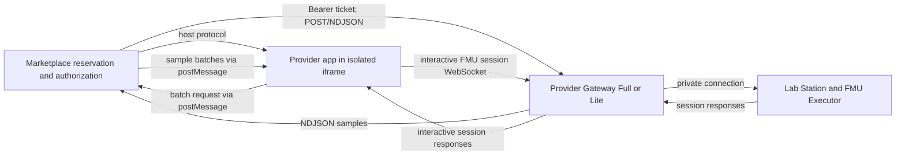

# Digital twin web app integration

A complete provider app owns its HMI. Marketplace embeds it in an isolated
iframe and keeps reservation credentials in the parent page. Finite batch runs
use a direct browser POST/NDJSON connection from the Marketplace host page to
the provider Gateway; interactive runs connect from the app iframe to the
Gateway WebSocket. The Gateway forwards execution to the private FMU Executor
on Lab Station.



The sequence below shows the transport split. The parent page obtains a
short-lived reservation ticket and makes finite batch requests directly to the
Gateway, relaying only bounded result batches to the iframe. Interactive
sessions use the same ticket-based authorization and send simulation traffic
directly from the app. The ticket is never sent to the opaque-origin iframe.

```mermaid
sequenceDiagram
  autonumber
  participant M as Marketplace
  participant A as Provider Three.js app
  participant G as Provider Gateway
  participant S as Lab Station FMU Executor
  M->>A: Embed app and complete Host Integration v2 handshake
  A->>M: Request reservation-scoped FMU connection grant
  alt finite fastest batch
    A->>M: Request batch HTTP transport
    M->>G: POST simulation stream with ticket in Authorization
    G->>S: Execute bounded batch
    S-->>G: Output samples
    G-->>M: NDJSON response stream
    M-->>A: Bounded sample batches and completion via postMessage
  else interactive, continuous or open-ended
    M->>G: Request grant through existing proxy.fmu ticket issuer
    G-->>M: Short-lived ticket and Gateway WSS endpoint
    M-->>A: Return connection grant to requesting iframe
    A->>G: Open WSS and create session with ticket
    G->>S: Redeem ticket and open private FMU session
    S-->>G: Session ready
    G-->>A: Session ready
    loop FMI execution
      A->>G: FMI operations and input values
      G->>S: Forward operations to the FMU
      S-->>G: Output samples
      G-->>A: Output samples
    end
  end
  Note over A,M: Marketplace cookies and reservation credentials stay in the host. The batch ticket stays in the host; a short-lived session ticket is sent to the iframe only for WebSocket setup.
```

There are two independent contracts:

* **Host integration v2**: app startup, a reservation-scoped connection grant
  and optional visualization controls. The machine-readable reference is
  [schema-v2.json](../../packages/digital-twin-app-protocol/schema-v2.json),
  mirrored in [the documentation schema](digital-twin-threejs-app-contract.schema.json).
* **FMU session protocol 1.0**: the existing Gateway WebSocket used by
  `proxy.fmu`. It creates a protected session and executes FMI operations. See
  [Gateway FMI/FMU support](https://github.com/DecentraLabsCom/Lab-Gateway/blob/main/docs/fmi-fmu-support.md).

FMI defines the FMU and importer API; the Gateway supplies its network transport.
The current session executor supports FMI 2/3 Co-Simulation. FMUs using Model
Exchange or Scheduled Execution can continue using Marketplace's generated
simulation interface and its existing execution API.

## App packaging and isolation

Link a complete static ZIP to the lab's AAS shell through Lab Manager's Digital
Twins tab. The provider supplies the entry HTML and all modules, WASM, charts,
styles, fonts and images at bundled relative paths. Gateway validates the asset
graph and stores the immutable bundle. Providers do not register individual
filenames or add modules to an app-specific Marketplace allowlist.

Marketplace proxies the selected files and runs the entry page in an iframe
with `sandbox="allow-scripts"`. The app has no Marketplace DOM, cookies or
storage access. Its HTML CSP permits connections only to the canonical
provider Gateway FMU WebSocket, plus its own bundled resources. HTML is not
cached because the canonical Gateway endpoint may change; immutable modules
and other bundle assets can be cached by digest.

The SDK is optional. An app can implement the documented messages directly or
use its own FMU client. A GLB scene is a separate presentation mode with
generated controls; it does not require this web app integration.

For Marketplace-maintained local demos, the app-specific bundling workflow and
shared static ZIP helper are documented in
[local Three.js demo build tooling](../development/local-threejs-demo-builds.md).

## Generated GLB viewer execution modes

For a reserved FMI 2/3 Co-Simulation lab linked to a GLB scene, the generated
Marketplace viewer offers three execution modes. They share the same starting
inputs and simulation-time settings:

| Mode | Runtime behavior | Runtime input changes |
| --- | --- | --- |
| **Batch** | The Marketplace browser page POSTs the run directly to Gateway and displays the returned samples for replay. | Schedule input or tunable-parameter changes at model times before starting. |
| **Step by step** | Opens a reservation-scoped FMU session in external time mode and sends one `sim.step` request when the user advances. | Edit runtime-writable variables while paused; the new values are sent before the next step. |
| **Continuous (live)** | Uses `sim.advance` to return bounded batches of intermediate samples. It starts with one sample and adapts from measured Executor compute cost, request cycle, payload size and confirmed presentation delay. It never changes the configured FMI step size. | Edit runtime-writable variables at any time; pending values are sent before the next batch. The current batch must finish before a new value can be applied. |

Continuous mode offers two pacing choices. **Real time (1x)** is the default; it
only requests simulation steps due by the real-time clock, targeting one
simulation second per real second. **Fastest** uses the adaptive or fixed batch
policy without a wall-clock cap. If model execution or Gateway communication is
slower, the scene falls behind the clock and continues without skipping model
steps. Pausing and resuming resets the pacing clock, so time spent paused does
not cause a jump.

The continuous batch controller targets a 200 ms full request cycle and a soft
50 ms Executor compute budget by default. Its compute budget is checked between
FMI steps, so one slow `doStep()` can exceed the budget; the response reports
that overrun. The response also includes measured compute time, sample count,
payload bytes, stop reason and the number of timed inputs applied. A latency floor
above the target is reported as unreachable instead of being mistaken for model
compute. When the app has not confirmed a rendered sample, the controller reserves
presentation time rather than treating the missing acknowledgement as zero.
During
interactive execution, the GLB viewer follows the latest sample instead of
replaying a queue at one simulation second per wall-clock second; all collected
samples remain available for replay after the run. The viewer shows the last and
planned batch sizes, model-time delta, request cycle, compute time, payload size,
presentation acknowledgement and stop reason. The batch limit is independent of
the configured simulation horizon. Omit `stopTime` for an open-ended SDK run;
the client keeps requesting finite bounded advances until cancellation, FMU
termination or the authorized session/runtime ends. The generated GLB viewer
also leaves Stop Time blank by default. Batch mode in that viewer requires a
finite stop time to delimit the collected result.

The Gateway enforces the effective AAS/FMI variable-access policy for runtime
writes and filters output values in both transports. The generated GLB viewer's
user-facing **Batch** mode uses the direct Gateway HTTP/NDJSON route. A Three.js
SDK run uses that route only when it is finite, uses Fastest Pace and fixed
batching, and has no input-controller, model-validation or parameter-derivation
callbacks. Other SDK runs use a short-lived connection grant and the Gateway
WebSocket directly. The iframe cannot attach Marketplace cookies or reservation
credentials. The provider Gateway must allow the exact Marketplace page origin
for its HTTPS batch route and FMU WebSocket. The Marketplace deployment must
include each provider Gateway's exact HTTPS and WSS origins in `CSP_CONNECT_SRC`;
its restrictive `connect-src` policy otherwise blocks the browser connection.
Production Gateway configuration supplies the Marketplace origin by default;
Preview deployments should set their Preview origin explicitly in the Gateway
CORS allowlist and the corresponding Gateway HTTPS/WSS origins in the Marketplace
CSP configuration.

## Authorization and connection

1. Marketplace establishes the authenticated reservation-scoped FMU access
   context using its existing access-code flow.
2. The app sends `decentralabs:digital-twin-connect` (version 2). Marketplace
   responds with `decentralabs:digital-twin-host-ready`. The host also sends
   this response after iframe load, so asynchronous React startup is supported.
3. Once its view is ready, the app sends `decentralabs:digital-twin-ready`.
4. The app requests a run with `decentralabs:fmu-connection-request`, a unique
   `requestId`, `options`, a transport preference and an execution pace. The SDK
   prefers `batch-http` only for finite Fastest runs with fixed batching and no
   input-controller, model-validation or parameter-derivation callbacks. The
   Marketplace host may authorize that transport; otherwise it returns a
   WebSocket grant. Omit `stopTime` for an open-ended run, which uses WebSocket.
5. For `batch-http`, the SDK sends `decentralabs:batch-execution-request` with
   the run parameters, finite time interval, optional scheduled changes and
   bounded sample preferences. Requested output variables and sample stride
   are passed to Gateway/Executor as simulation options, while the parent
   enforces the iframe batch size and message-size limits. When the batch
   starts, the host obtains a fresh reservation-scoped ticket through its
   existing authorization endpoint and keeps it in memory, then POSTs directly
   to the returned Gateway origin at `/fmu/api/v1/simulations/stream` with the
   ticket in the `Authorization` header. It reads NDJSON and relays sample
   batches of at most 256 samples and 1 MB to the iframe. The SDK acknowledges each batch with
   `decentralabs:batch-execution-ack`; the parent waits for that acknowledgement
   before reading further, so a slow renderer does not accumulate the full run
   in the iframe. Cancellation aborts the parent request. The iframe never
   receives the Marketplace cookie or reservation key.
6. For `websocket`, Marketplace calls `POST /api/simulations/connection`,
   forwarding only its server-side resource credential to the authorized
   Gateway endpoint `POST /fmu/api/v1/fmu/connection/{labId}?reservationKey=...`.
   Gateway uses the **same ticket issuance service and authorization checks as
   proxy.fmu**. Full gateways use their issuer; Lite gateways use their configured
   remote Full/standalone issuer. Marketplace validates the returned endpoint,
   lab, reservation and ticket expiry before returning the scoped grant.
7. The app opens the returned `gatewayWsUrl` and sends `session.create` with
   the short-lived ticket. Gateway redeems it with the existing issuer service,
   rechecks the reservation and creates the Station session. Session-start
   evidence, revocation, quotas and expiry use the existing proxy.fmu path.

When the FMU has an AAS variable-access policy, Gateway also enforces the
effective permissions on this WebSocket session. It rejects unauthorized
initialization/runtime writes, filters unreadable values from session replies,
and returns only permitted variables from `model.describe`. Three.js apps must
handle a Gateway `VARIABLE_ACCESS_DENIED` error when an operation is not
allowed. The Marketplace host connection messages and schema do not carry the
policy or replace this Gateway enforcement.

Connection grants and API responses use `Cache-Control: no-store`. Keep a grant
only in memory. For batch, the ticket remains in the Marketplace host and is
never sent to the iframe; for WebSocket, the host sends the scoped connection
grant to the iframe only for the session handshake. Never place tickets in
URLs, logs, local storage or app ZIPs. The app never receives the Marketplace
session cookie, Gateway JWT or Station internal token. Tickets are short-lived
and reservation-bound; request a fresh grant for a new run.

A WebSocket connection response has this shape:

```js
{
  type: 'decentralabs:fmu-connection-ready', version: 2, requestId: 'grant:example',
  connection: {
    protocolVersion: '1.0',
    gatewayWsUrl: 'wss://provider.example/fmu/api/v1/fmu/sessions',
    labId: '42', reservationKey: 'reservation:example',
    sessionTicket: '<short-lived capability>', ticketExpiresAt: 1790000000,
  },
  inputSchedule: [],
}
```

A batch grant has no ticket or connection details. It advertises only that the
parent can execute a finite POST stream and may provide the FMU's default start
time, step size, authorized input schedule and state-capture availability.

`decentralabs:fmu-connection-error` returns the same request ID and a bounded
error code. The connection-ready message can carry the authorized `inputSchedule`
shown above. In batch mode, the dedicated request and event messages carry the
app's run parameters and bounded output sample batches. Host messages must come
from `window.parent`; the host accepts app messages only from the current iframe
window. All field sets are closed.
Unknown message types and optional capabilities are ignored. Namespaced
`host-ready.extensions` allow explicitly configured host data.

## Optional SDK

The package `@decentralabs/digital-twin-app-protocol` provides:

* the root entry: host v2 constants, validators and types;
* `/fmu-client`: `connectFmuSession(connection)`, independent of Marketplace;
* `/client`: `createDigitalTwinAppClient()`, composing the direct FMU client
  with optional host startup, authorization and visualization controls.
* `/simulation-stream`: shared NDJSON parsing and event normalization for
  SDK-hosted batch runs and GLB execution.

With a bundler, import the desired entry. For a static app without a bundler,
copy `index.js`, `fmu-client.js`, `parameter-defaults.js`,
`batch-controller.js`, `simulation-stream.js`, `input-update-quota.js`, `client.js` and
`LICENSE.txt` together into `sdk/` in the ZIP. If the app also exports GLB scenes, copy
`scene-presentation.js` into that directory too.
When bundling the SDK into an app, include its `LICENSE.txt` in the delivered app or third-party notices.
After a version is released, download the `.tgz` from the [Marketplace GitHub Releases page](https://github.com/DecentraLabsCom/Marketplace/releases)
and install it in the provider app project with `npm install ./decentralabs-digital-twin-app-protocol-X.Y.Z.tgz`.
Each `digital-twin-app-protocol-vX.Y.Z` tag creates a release with the tarball and SHA-256 checksum; its version must match the package version. From a Marketplace checkout, the same package can be built with `npm pack --workspace @decentralabs/digital-twin-app-protocol`. The package is not currently published to the npm registry.

The SDK is licensed under Apache-2.0, separately from the Marketplace repository's root GPL-3.0-only license. Include `LICENSE.txt` when copying SDK files into an app ZIP.

```js
import { createDigitalTwinAppClient } from './sdk/client.js'
const twin = createDigitalTwinAppClient({
  onFmiLsParameterPreset(preset) {
    applyFmuParameters(preset.parameters)
  },
  onSamples(samples, batch, { signal }) {
    appendReplaySamples(samples)
  },
  onReset() { clearReplay() },
  onSimulationState(state) { updateRunStatus(state) },
  onResultsComplete({ state, sampleCount }) { finishTimeline(state, sampleCount) },
  onPlaybackRate(rate) { replay.setRate(rate) },
})
initializeView().then(() => twin.reportReady()).catch(() => twin.reportError('APP_INIT_FAILED'))
runButton.onclick = () => twin.run({ parameters: readFmuInputs(), options: { stopTime: 220 } }).catch(showRunError)
window.addEventListener('pagehide', () => twin.dispose(), { once: true })
```

For independent hosting, supply `getConnection: async ({ options, signal }) =>
connectionGrant` using the app's own authorized backend. That execution does
not require a Marketplace parent. Low-level clients can call
`connectFmuSession()` and use `session.request(type, expectedResponse, payload)`
for any supported FMU session operation.

The convenience client resolves `run()` after session creation and initialization.
It requires FMU Executor 0.3.2 or newer and the advertised `advanceSamples`
capability. Upgrade the Gateway and Station runtime before publishing a rebuilt
app that uses this runner.
It reads the authorized model description with `model.describe` and
`includeVariables: true` before initialization, then uses `sim.advance` to
obtain up to 256 samples per response. The Executor bounds the encoded frame
by output names and scalar sizes. The SDK accepts up to 512 outputs with names
up to 256 characters, and a 1,000,000-byte limit for ordinary response frames.
Model descriptions have a separate 32 MiB ceiling.

The convenience client defaults to adaptive batches for Realtime Pace and fixed
batches for Fastest Pace. Adaptive mode adjusts the next `sim.advance` batch from
measured per-sample compute, full request cycle, payload size and confirmed
presentation delay. Defaults target a 200 ms request cycle, a soft 50 ms compute
budget and a 50 ms presentation reserve when there is no render acknowledgement.
The app can tune these with `adaptiveBatchOptions` and set `maxBatchSamples` as a
hard cap. Adaptive mode requires the runtime's `advanceComputeBudget` and
`advanceSampleSequences` capabilities. An `inputController` with no interval or
scheduled times receives every sample and keeps one-sample feedback; default
Realtime runs select that behavior automatically, while explicitly combining
adaptive batching with per-sample feedback is rejected. Controllers with
`inputControllerInterval` or `inputControllerTimes` can use adaptive batches,
which end at the next requested controller time. To include actual presentation
time, an app can provide
`onBatchRendered`; the client awaits it after `onSamples` and the app resolves it
after its renderer has drawn the batch's last sample. Without that callback,
presentation remains unknown and the controller uses its reserve.
Apps that implement the protocol without the convenience client manage their own
batching.

Apps using the convenience client can opt in to a user-facing Pace selector with
`executionPaceControl: true`. The app may select its initial
`defaultExecutionPace` and receive the effective value through
`onExecutionPace`. Marketplace includes the user's choice in the next
connection grant, and the SDK applies it to that run. **Real time (1x)** paces
advances to the wall clock and uses adaptive batches containing output samples
that are due; if execution, callbacks or communication fall behind, the
simulation follows without skipping steps. **Fastest** uses the app's batching
configuration. Batch policy, sample caps and adaptive-controller settings
remain developer choices in `run()`.

Sample callbacks may be asynchronous. The client requests another batch only
after the preceding callback finishes, and respects the session's advertised
output rate. With `onSamples`, batches are delivered once; otherwise each entry
goes to `onSample`. `onResultsComplete` runs after the last callback, with the
terminal state and sample count. Reset, cancellation and disposal abort the
callback context; an asynchronous callback must check `signal.aborted` after
awaiting and before committing UI changes. Callback failure stops execution.

`run({ inputSchedule })` applies bounded runtime variable changes at their
model times. The host schedule may contain FMU inputs and, for FMI 3
Co-Simulation models, parameters declared `tunable` when the effective access
policy grants runtime writes. Those changes take effect at a communication
point. `inputSchedule` supplies the app's effective schedule and replaces the
schedule returned by the host. To preserve and extend the host-authorized
schedule, use `composeInputSchedule(providerSchedule)` instead; it receives a
copy and returns the complete effective schedule. The two run options are
mutually exclusive. An optional `inputController(sample, context)` callback returns changed
runtime-writable variables for closed-loop apps, including FMI 2.0 and FMI 3.0
Co-Simulation tunable parameters when permitted. Without an interval or
scheduled controller times, it advances one sample per request so feedback can
affect the next step. With `inputControllerInterval` or `inputControllerTimes`,
the SDK can batch until the next controller boundary. Controller updates are
combined with the next `sim.advance` through `inputValues` when the runtime
advertises `advanceInputValues`; otherwise the SDK sends `sim.setInputs` before
advancing. Both paths use the Gateway's normal write authorization and quota
checks. Water Tank owns its controller and fault logic in the app and uses this
mode in one FMU execution.

## Optional host visualization controls

Marketplace groups its Three.js host controls under one floating button in the
bottom-left corner. The menu contains playback speed, system configurations,
FMI-LS-REF experiments, scheduled input changes, FMI-LS-STRUCT maps, and
cancellation when each feature is available. Apps that declare
`execution-pace` also receive a Pace selector. The schedule editor and
FMI-LS-STRUCT maps open in dialogs; simple controls stay in the menu.
Gateway FMI metadata and reservation permissions determine availability on
both GLB and Three.js routes. FMI-LS-STRUCT maps are rendered by Marketplace
from the authorized Gateway metadata, so they do not need an app capability.
Three.js requires an SDK capability only for controls that need the app to
receive or report something.

* `playback-rate` enables Speed controls in that menu. `defaultPlaybackRate`
  sets the starting rate. Marketplace fixes the menu to the bottom-left corner;
  `playbackControlPosition` does not move it.
  `decentralabs:fmi-playback-control` changes visualization speed only.
* `execution-pace` is enabled by the SDK client's `executionPaceControl: true`
  option. `defaultExecutionPace` chooses the starting value. The SDK applies the
  user's Pace selection to its next `run()`; this controls model execution,
  independently of Replay speed. Real-time pacing uses one output sample per
  advance, while `batchPolicy` and adaptive options remain app-developer
  settings.
* `execution-control` allows the app to report `decentralabs:execution-state`
  with run ID, lifecycle state and time options. Marketplace uses these values
  for its Cancel simulation control and Fit to run duration. They are UI
  information, not authorization or billing evidence.
  `decentralabs:execution-cancel` asks the app to terminate its own direct
  session.
* `fmi-ls-parameter-presets` is advertised when the SDK client is given an
  `onFmiLsParameterPreset` callback. Marketplace displays the FMU's
  reservation-authorized FMI-LS-REF parameter sets in host UI and calls the
  callback with `{ id, name, description, parameters }` when a selection is
  applied. The app should update its visible controls and use those parameters
  in its next initialization.
* `fmi-ls-experiments` is advertised by the SDK client. When the reservation
  includes supported, authorized FMI-LS-REF experiments, Marketplace adds an
  Experiment selector to the floating menu and sends the selected experiment
  in `decentralabs:fmi-ls-experiment`. Until cleared, its parameter set
  replaces app-supplied run parameters, and its declared time options override
  matching options in subsequent `run()` calls. FMU defaults apply to
  variables not listed in the experiment. An optional
  `onFmiLsExperiment(experiment)` callback can keep
  app-owned controls in sync; it receives `null` when the selection is
  cleared. The host filters unsupported cases and parameters the reservation
  cannot write.
* When enabled by the host and supported by the model, the schedule editor
  adds validated `inputSchedule` events to the connection response. The SDK
  applies them through the FMU client; no app capability declaration is
  needed.
  Events may change runtime-writable FMI inputs or FMI 2.0/FMI 3.0
  Co-Simulation tunable parameters; the Gateway remains authoritative for the
  effective access policy.
* An explicitly configured host may support `decentralabs:digital-twin-model-change`.
  Normal published labs remain bound to their configured FMU. The qFMU local
  preview uses this extension to select among its four reference models.

## Three.js scene / GLB presentation parity

The optional `@decentralabs/digital-twin-app-protocol/scene-presentation`
subpath defines a version 1 JSON profile for Three.js presentation settings,
including OrbitControls behavior such as damping and pan/zoom/rotate options.
Renderer settings include the active pixel ratio and clear color/alpha used by the source app.
The SDK's canonical exporter captures the active camera, OrbitControls,
renderer, scene background and fog. It stores this versioned
`decentralabsScenePresentation` profile in glTF scene extras. Per-object shadow,
visibility and material render flags are serialized with the corresponding
node or material extras. Ambient lights and their direction are represented in
the profile; punctual lights and PBR materials use standard glTF fields. The
exporter preserves directional and spot-light aim from their Three.js targets
and snapshots matrix transforms before restoring the live scene, without
changing the exporter's matrix or TRS representation.

Apps call `exportSceneWithPresentation({ THREE, scene, camera, renderer,
controls, exporter, options })`. The exporter includes initially hidden
geometry, preserves Three.js `LineBasicMaterial` as unlit glTF materials, and
preserves directional and spot-light aim from their targets in the exported
transforms before restoring the live scene. The Marketplace viewer reads
the profile and restores it without lab-specific branches. The schema is
published as `@decentralabs/digital-twin-app-protocol/scene-presentation-schema`.

The contract covers what Three.js draws into its canvas. HTML HUDs and CSS
layers above the canvas are excluded; apps should remove visual overlays that
alter the canvas before export. If a caller supplies `surfaceElement`, marking
such an overlay with `data-decentralabs-scene-overlay` makes export fail
explicitly. Custom shaders, non-normal blending, custom environment textures,
orthographic cameras, post-processing, and other features outside the portable
glTF model are unsupported until represented by a shared format. Pixel-level
comparison also requires the same viewport aspect ratio and rendering device.

Marketplace apps use host integration protocol version 2. The native
`proxy.fmu` WebSocket session protocol is version 1.0 and supports the bounded
`sim.advance` operation for batched output samples.

Last reviewed: 2026-10-29
