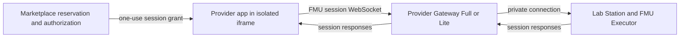
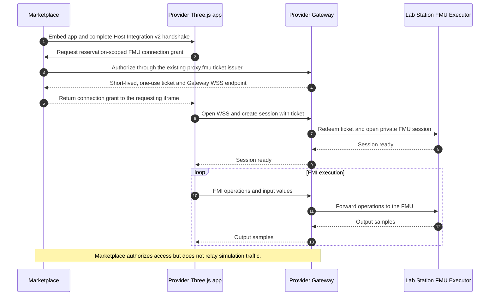

# Digital twin web app integration

A complete provider app owns its HMI and connects directly from the user browser
to the provider Gateway. The Gateway forwards execution to the private FMU
Executor on Lab Station. Marketplace authorizes access and embeds the app;
simulation inputs and output samples do not pass through Marketplace.



The sequence below shows how these responsibilities work together. Marketplace
authorizes and issues the one-use grant; after that, the app's FMU session and
all simulation traffic use the provider Gateway directly.



There are two independent contracts:

* **Host integration v2**: app startup, a reservation-scoped connection grant
  and optional visualization controls. The machine-readable reference is
  [schema-v2.json](../../packages/digital-twin-app-protocol/schema-v2.json),
  mirrored in [the documentation schema](digital-twin-threejs-app-contract.schema.json).
* **FMU session protocol 1.0**: the existing Gateway WebSocket used by
  `proxy.fmu`. It creates a protected session and executes FMI operations. See
  [Gateway FMI/FMU support](https://github.com/DecentraLabsCom/Lab-Gateway/blob/main/docs/fmi-fmu-support.md).

FMI defines the FMU and importer API; the Gateway supplies its network transport.
The current session executor supports FMI 2/3 Co-Simulation. FMUs using Model
Exchange or Scheduled Execution can continue using Marketplace's generated
simulation interface and its existing execution API.

## App packaging and isolation

Link a complete static ZIP to the lab's AAS shell through Lab Manager's Digital
Twins tab. The provider supplies the entry HTML and all modules, WASM, charts,
styles, fonts and images at bundled relative paths. Gateway validates the asset
graph and stores the immutable bundle. Providers do not register individual
filenames or add modules to an app-specific Marketplace allowlist.

Marketplace proxies the selected files and runs the entry page in an iframe
with `sandbox="allow-scripts"`. The app has no Marketplace DOM, cookies or
storage access. Its HTML CSP permits connections only to the canonical
provider Gateway FMU WebSocket, plus its own bundled resources. HTML is not
cached because the canonical Gateway endpoint may change; immutable modules
and other bundle assets can be cached by digest.

The SDK is optional. An app can implement the documented messages directly or
use its own FMU client. A GLB scene is a separate presentation mode with
generated controls; it does not require this web app integration.

## Authorization and connection

1. Marketplace establishes the authenticated reservation-scoped FMU access
   context using its existing access-code flow.
2. The app sends `decentralabs:digital-twin-connect` (version 2). Marketplace
   responds with `decentralabs:digital-twin-host-ready`. The host also sends
   this response after iframe load, so asynchronous React startup is supported.
3. Once its view is ready, the app sends `decentralabs:digital-twin-ready`.
4. To start execution, the app requests a connection with
   `decentralabs:fmu-connection-request`, a unique `requestId` and optional
   `options` containing finite `startTime`, `stopTime` and `stepSize` values.
5. Marketplace calls `POST /api/simulations/connection`, forwarding only its
   server-side resource credential to the authorized Gateway endpoint
   `POST /fmu/api/v1/fmu/connection/{labId}?reservationKey=...`.
6. Gateway uses the **same ticket issuance service and authorization checks as
   proxy.fmu**. Full gateways use their issuer; Lite gateways use their configured
   remote Full/standalone issuer. Marketplace validates the returned endpoint,
   lab, reservation and ticket expiry before returning the grant to that iframe.
7. The app opens the returned `gatewayWsUrl` and sends `session.create` with
   the one-use ticket. Gateway redeems it with the existing issuer service,
   rechecks the reservation and creates the Station session. Session-start
   evidence, revocation, quotas and expiry use the existing proxy.fmu path.

Connection grants and API responses use `Cache-Control: no-store`. Keep a grant
only in memory until used. Never place tickets in URLs, logs, local storage or
app ZIPs. The app never receives the Marketplace session cookie, Gateway JWT
or Station internal token. A new execution obtains a fresh grant; a consumed
ticket must not be retried as a new session.

A connection response has this shape:

```js
{
  type: 'decentralabs:fmu-connection-ready', version: 2, requestId: 'grant:example',
  connection: {
    protocolVersion: '1.0',
    gatewayWsUrl: 'wss://provider.example/fmu/api/v1/fmu/sessions',
    labId: '42', reservationKey: 'reservation:example',
    sessionTicket: '<one-use capability>', ticketExpiresAt: 1790000000,
  },
  inputSchedule: [],
}
```

`decentralabs:fmu-connection-error` returns the same request ID and a bounded
error code. No simulation parameters or output samples are carried by these
host messages. Host messages must come from `window.parent`; the host accepts
app messages only from the current iframe window. All field sets are closed.
Unknown message types and optional capabilities are ignored. Namespaced
`host-ready.extensions` allow explicitly configured host data.

## Optional SDK

The package `@decentralabs/digital-twin-app-protocol` provides:

* the root entry: host v2 constants, validators and types;
* `/fmu-client`: `connectFmuSession(connection)`, independent of Marketplace;
* `/client`: `createDigitalTwinAppClient()`, composing the direct FMU client
  with optional host startup, authorization and visualization controls.

With a bundler, import the desired entry. For a static app without a bundler,
copy `index.js`, `fmu-client.js` and `client.js` together into `sdk/` in the ZIP.
Create a package tarball with `npm pack --workspace @decentralabs/digital-twin-app-protocol`.
The workspace does not publish the npm package automatically.

```js
import { createDigitalTwinAppClient } from './sdk/client.js'
const twin = createDigitalTwinAppClient({
  onSamples(samples, batch, { signal }) {
    appendReplaySamples(samples)
  },
  onReset() { clearReplay() },
  onSimulationState(state) { updateRunStatus(state) },
  onResultsComplete({ state, sampleCount }) { finishTimeline(state, sampleCount) },
  onPlaybackRate(rate) { replay.setRate(rate) },
  playbackControlPosition: 'bottom-right',
})
initializeView().then(() => twin.reportReady()).catch(() => twin.reportError('APP_INIT_FAILED'))
runButton.onclick = () => twin.run({ parameters: readFmuInputs(), options: { stopTime: 220 } }).catch(showRunError)
window.addEventListener('pagehide', () => twin.dispose(), { once: true })
```

For independent hosting, supply `getConnection: async ({ options, signal }) =>
connectionGrant` using the app's own authorized backend. That execution does
not require a Marketplace parent. Low-level clients can call
`connectFmuSession()` and use `session.request(type, expectedResponse, payload)`
for any supported FMU session operation.

The convenience client resolves `run()` after session creation and initialization.
It requires FMU Executor 0.3.2 or newer and the advertised `advanceSamples`
capability. Upgrade the Gateway and Station runtime before publishing a rebuilt
app that uses this runner.
It reads model defaults with `model.describe` and `includeVariables: false`,
then uses `sim.advance` to obtain up to 256 samples per response. The Executor
bounds the encoded frame by output names and scalar sizes. The SDK accepts up
to 512 outputs with names up to 256 characters, and a 1 MB frame limit.

Sample callbacks may be asynchronous. The client requests another batch only
after the preceding callback finishes, and respects the session's advertised
output rate. With `onSamples`, batches are delivered once; otherwise each entry
goes to `onSample`. `onResultsComplete` runs after the last callback, with the
terminal state and sample count. Reset, cancellation and disposal abort the
callback context; an asynchronous callback must check `signal.aborted` after
awaiting and before committing UI changes. Callback failure stops execution.

`run({ inputSchedule })` applies bounded input events at their model times. An
optional `inputController(sample, context)` callback returns changed runtime
inputs for closed-loop apps. That mode advances one sample per request so
feedback can affect the next step; network latency therefore limits controller
speed. Water Tank owns its controller and fault logic in the app and uses this
mode in one FMU execution.

## Optional host visualization controls

* `playback-rate` enables the floating Speed menu. `playbackControlPosition`
  selects `top-left`, `top-right`, `bottom-left` or `bottom-right`.
  `decentralabs:fmi-playback-control` changes visualization speed only.
* `execution-control` allows the app to report `decentralabs:execution-state`
  with run ID, lifecycle state and time options. Marketplace uses these values
  for its cancel button and Fit to run duration. They are UI information, not
  authorization or billing evidence. `decentralabs:execution-cancel` asks the
  app to terminate its own direct session.
* The optional host input-schedule editor adds validated `inputSchedule` events
  to the connection response. The app applies them through its FMU client.
* An explicitly configured host may support `decentralabs:digital-twin-model-change`.
  Normal published labs remain bound to their configured FMU. The qFMU local
  preview uses this extension to select among its four reference models.

Marketplace apps use host integration protocol version 2. The native
`proxy.fmu` WebSocket session protocol is version 1.0 and supports the bounded
`sim.advance` operation for batched output samples.

Last reviewed: 2026-10-24
